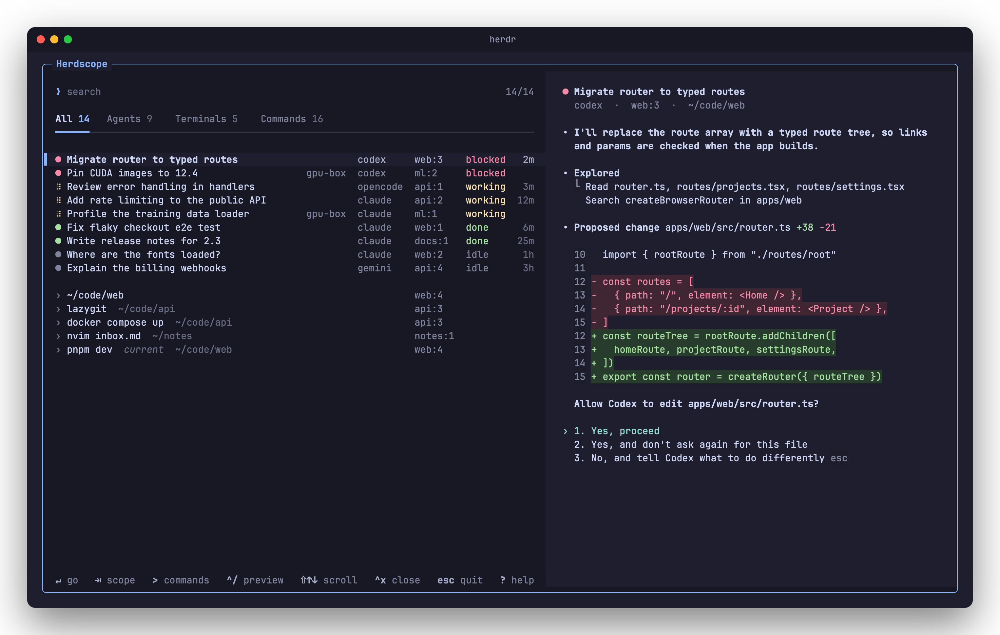

<div align="center">

# Herdscope

**A fuzzy finder for everything in [Herdr](https://herdr.dev).**

Every agent, terminal and command in one list, ranked by what needs you, with a live preview.

[](https://github.com/emanuel2718/herdscope/actions/workflows/ci.yml)
[](https://herdr.dev)
[](https://www.python.org)
[](#install)
[](LICENSE)

[Install](#install) · [Usage](#usage) · [Search](#search) · [Commands](#commands) ·
[Machines](#other-machines) · [Colors](#colors) · [Performance](#performance) · [FAQ](#faq)

<br>



</div>

## Features

- **Everything in one list.** Agents with their task, status and how long they've held it
  (`blocked 2m`); terminals with their command and folder; agents on your other machines.
- **Ranked by what needs you.** With an empty search, blocked agents come first, then working,
  done and idle. Panes you visit often and recently rank higher among equals.
- **Live previews.** The selected pane's output, in its own colors, updating as it changes,
  with scrollback.
- **fzf's matching, built in.** A port of fzf's algorithm and search syntax, tested against
  fzf itself. fzf doesn't need to be installed.
- **Herdr's commands.** Type `>` to rename, split, zoom or close; start an agent; make a
  worktree; or run another plugin's action. Each command previews what it will do.
- **Your colors.** Your terminal's palette, or Herdr's `[theme]` if you set one.
- **Fast at any size.** Under 50 ms to open, a few milliseconds a keystroke with a thousand
  panes, and nothing running while it's closed but two tiny hooks. See [Performance](#performance).
- **No dependencies.** Python's standard library and `sh`; `herdr plugin install` is all it takes.

## Install

Requires [Herdr](https://herdr.dev) 0.9.1 or newer and Python 3.11 or newer, on macOS or Linux.

```sh
herdr plugin install emanuel2718/herdscope
```

Then bind a key to it in Herdr's `config.toml` (`prefix+f` is free by default):

```toml
[[keys.command]]
key = "prefix+f"
type = "plugin_action"
command = "emanuel2718.herdscope.open"
description = "Herdscope"
```

Reload Herdr's config with `herdr server reload-config`, press the key, and Herdscope opens over
your panes.

> [!NOTE]
> Herdr runs plain `python3`. On macOS that may be Apple's Python 3.9, which is too old; if it
> is, Herdscope says so when it opens. Install a newer one (`brew install python`) and make sure
> it comes first on the `PATH` Herdr starts with.

To update, run `herdr plugin update`. To remove it, `herdr plugin uninstall emanuel2718.herdscope`.

## Usage

Open Herdscope, type a few letters of what you're looking for, and press `Enter` to go there.

| Key                              | Action                                                    |
| -------------------------------- | --------------------------------------------------------- |
| `Enter` `Ctrl-Y`, double-click   | Go to the pane, or run the command                        |
| `↑` `↓` `Ctrl-N` `Ctrl-P`, wheel | Move through the list; `PgUp` `PgDn` by a page            |
| `Tab` `Shift-Tab`, click         | Switch between All, Agents, Terminals and Commands        |
| `>`                              | Search commands; `Backspace` on an empty search goes back |
| `Ctrl-/`                         | Show or hide the preview                                  |
| `Shift-↑` `Shift-↓`, wheel       | Scroll back through the preview                           |
| `Ctrl-X`, then `y`               | Close the pane                                            |
| `?` on an empty search, `F1`     | Show every key and the search syntax                      |
| `Esc` `Ctrl-C`                   | Quit, or leave a command's input                          |

The search edits like a shell prompt: `Ctrl-A` `Ctrl-E` `Ctrl-W` `Ctrl-U` `Alt-B` `Alt-F`.

## Search

Herdscope uses fzf's matching and its extended search syntax.

| Term     | Matches                             |
| -------- | ----------------------------------- |
| `sbtrkt` | Fuzzy: those letters, in that order |
| `'wild`  | Exactly `wild`                      |
| `'wild'` | The whole word `wild`               |
| `^music` | Starting with `music`               |
| `.mp3$`  | Ending with `.mp3`                  |
| `!fire`  | Not containing `fire`               |
| `a \| b` | Either `a` or `b`                   |

Terms separated by spaces must all match. A term is case-sensitive only if it has an uppercase
letter, and one without accents matches accented text (`cafe` finds `café`).

Each pane is matched as one line: its task or command, folder, `workspace:tab`, agent, status
and machine. So `blocked` finds every agent waiting on you, and `api blocked` those in the
`api` workspace.

With an empty search, agents come first, in attention order (blocked, working, done, idle),
then terminals. The pane you opened Herdscope from is tagged `current` and sinks to the bottom
of its group.

## Commands

Type `>` from anywhere to search Herdr's commands. They act on the pane you opened Herdscope
from, its tab and its workspace, and each row shows your key binding for it.

| Group      | Commands                                                             |
| ---------- | -------------------------------------------------------------------- |
| Workspaces | New, rename, move up, move down, close                               |
| Tabs       | New, rename, close                                                   |
| Panes      | Split right, split down, zoom, rename, close                         |
| Agents     | Start any agent Herdr supports that you have installed, in a new tab |
| Also       | New Git worktree, reload Herdr's config, your other plugins' actions |

Commands ending in `…` ask for a name, and the preview shows the result as you type. Closing
asks for `y` first, and the preview lists everything that will stop.

## Other machines

Agents on the machines in `herdr machine list` appear alongside your local panes, named by
their machine. A slow or offline machine never holds up the rest: until it answers, its
agents show as Herdscope last saw them, with their status dimmed.

Each machine refreshes every eight seconds, and machines whose agents haven't changed are asked
less often. Past 80 machines, refreshes spread out to stay around ten requests a second.

You can preview and focus remote agents, but not remote terminals, and remote panes can't be
closed from here. Herdr has no way for a plugin to switch the machine on screen, so after you
focus a remote agent, Herdscope tells you which machine to pick in Herdr's sidebar.

## Colors

Without a `[theme]` in Herdr's config, Herdscope takes your terminal's colors: its text,
background and ANSI palette, with shades in between mixed from them. The accent is Herdr's, so
it matches the popup's border.

With a `[theme]`, it follows Herdr's: the built-in `name`s, `auto_switch` with `dark_name` and
`light_name`, and `[theme.custom]` overrides. `[ui] accent` and
`status_indicators = "symbols"` apply too.

## Performance

Herdscope is built to stay out of the way, however many panes you have.

| What                                     | Cost                                                    |
| ---------------------------------------- | ------------------------------------------------------- |
| Opening the popup                        | ~45 ms to the first frame, ~17 ms of it Python starting |
| A keystroke, 1,000 panes                 | ~3 ms                                                   |
| A keystroke, 10,000 panes                | ~25 ms; backspacing ~1.5 ms                             |
| The open popup, with agents working      | ~3% of one core, mostly animating their spinners        |
| An agent's status changes (popup closed) | ~3 ms of CPU, in `sh`                                   |
| You focus a pane (popup closed)          | ~30 ms of CPU, to count the visit                       |

Measured on an Apple M2 Max with Python 3.15. How it gets there:

- **Nothing runs while it's closed** but the two hooks above. At 300 agents each changing status
  once a minute, the status hook uses under 2% of one core.
- **Matching scores only where letters occur.** Ranking runs fzf's scoring recurrence, but
  visits only the positions where each letter of the query appears, found in C, and skips the
  rest; highlighting is worked out only for rows on screen. Typing on only re-checks what still
  matched, and going back to an earlier search reuses its results.
- **Refreshes do only what changed.** Local panes refresh once a second over Herdr's socket; an
  unchanged snapshot costs nothing more, and only changed panes are re-ranked and re-matched.
- **Slow things stay off the UI thread.** Previews, refreshes and other machines are read in the
  background, and only the selected pane's preview is read.
- **The screen gets only what changed.** Each frame is diffed against the last, so a spinner
  costs one cell, and the popup wakes at a spinner's pace only while one is on screen.

## FAQ

<details>
<summary><b>The key does nothing.</b></summary>

Check that the binding's `command` is `emanuel2718.herdscope.open` and that the plugin is
enabled with `herdr plugin list`. `herdr plugin log list --plugin emanuel2718.herdscope` shows
what ran and any error.
</details>

<details>
<summary><b>The popup says it needs Python 3.11 or newer.</b></summary>

Herdr runs the first `python3` on the `PATH` it started with. Install Python 3.11 or newer,
make sure it comes first on that `PATH`, and restart Herdr's server.
</details>

<details>
<summary><b>Agents show their status but not how long they've had it.</b></summary>

Those times come from a hook that notes each status change as it happens, so an agent shows one
from its next change after Herdscope is installed. Changes Herdscope sees while it's open count
too.
</details>

<details>
<summary><b>What does Herdscope store, and where?</b></summary>

Everything lives in `~/.local/state/herdr/plugins/emanuel2718.herdscope/`: your visit counts
(`history.sqlite3`, kept for 90 days), when each agent's status began (`status/`), and the last
panes seen on other machines (`machines.json`). It reads Herdr's `config.toml` for your theme
and keys. It makes no network connections of its own. See [SECURITY.md](SECURITY.md).
</details>

## Contributing

Bug reports, ideas and pull requests are welcome. [CONTRIBUTING.md](CONTRIBUTING.md) covers the
setup, which takes one command, how the code fits together, and what keeps it fast.

```sh
herdr plugin link "$PWD"     # run this checkout instead of the installed copy
python3 -m unittest          # run the tests; no dependencies
```

## License

[MIT](LICENSE)
